# [Classification Prediction] Based on PSO-LSTM for Prediction and Classification [with MATLAB Code]

I. Research on Sentiment Classification of Chinese Weibo Based on PSO-LSTM
II. Power Load Forecasting Model Based on PSO-LSTM
III. MATLAB Simulation Test
MATLAB Code
%% Particle Swarm Optimization LSTM (PSO_LSTM)\nclc\nclear\nclose  all\n%% Data Reading\ngeshu=200;%Number of training sets\n% Read data\nshuru=xlsread('input.xlsx');\nshuchu=xlsread('output.xlsx');\nnn = randperm(size(shuru,1));% Random sorting\n% nn=1:size(shuru,1);% Normal sorting\ninput_train =shuru(nn(1:geshu),:);\ninput_train=input_train';\noutput_train=shuchu(nn(1:geshu),:);\noutput_train=output_train';\ninput_test =shuru(nn((geshu+1):end),:);\ninput_test=input_test';\noutput_test=shuchu(nn((geshu+1):end),:);\noutput_test=output_test';\n% Normalize sample input and output data\n[aa,bb]=mapminmax([input_train input_test]);\n[cc,dd]=mapminmax([output_train output_test]);\nglobal inputn outputn shuru_num shuchu_num XValidation YValidation\n[inputn,inputps]=mapminmax('apply',input_train,bb);\n[outputn,outputps]=mapminmax('apply',output_train,dd);\nshuru_num = size(input_train,1); % Input dimensions\nshuchu_num = 1;  % Output dimension\ndam = 10; % Number of validation sets, which are the data from the training set\nidx = randperm(size(inputn,2),dam);\nXValidation = inputn(:,idx);\ninputn(:,idx) = [];\nYValidation = outputn(idx);\noutputn(idx) = [];\nYValidationy = output_train(idx);\noutput_train(idx) = [];\n%%\n% 1. Finding the best parameters\nNN=5;                   % Initialize the number of groups\nD=2;                    % Initialize the population dimension.\nT=10;                   % Initialize the number of iterations for the population\nc1=2;                   % Learning factor 1\nc2=2;                   % Learning factor 2\n% Linearly Decreased Factor Particle Swarm Algorithm\nWmax=1.2; % Inertia weight maximum value\nWmin=0.8; % Inertia weight minimum value\n%%%%%%%%%%%%%%%%%%%%%%%%%%%%%%%%%%%%%%%%%%%%%%%%%%%%%%%%%%\n%%%%%%%%%%%%%%%%%%%%%%%%%%%%%%%%%%%%%%%%%%%%%%%%%%%%%%%\n% The range of values for each variable\nParticleScope(1,:)=[10 200];  % Number of intermediary layer neurons\nParticleScope(2,:)=[0.01 0.15]; % Learning rate\nParticleScope=ParticleScope';\n%%%%%%%%%%%%%%%%%%%%%%%%%%%%%%%%%%%%%%%%%%%%%%%%%%%%%%%%%%%%%%%%%%\n%%%%%%%%%%%%%%%%%%%%%%%%%%%%%%%%%%%%%%%%%%%%%%%%%%%%%%%%%%%%%%%%%%\nxv=rand(NN,2*D); % First, initialize the population individuals' velocity and position\nfor d=1:D\n    xv(:,d)=xv(:,d)*(ParticleScope(2,d)-ParticleScope(1,d))+ParticleScope(1,d);  \n    xv(:,D+d)=(2*xv(:,D+d)-1 )*(ParticleScope(2,d)-ParticleScope(1,d))*0.2;\nend\nx1=xv(:,1:D);% Position\nv1=xv(:,D+1:2*D);% Speed\n%%%%%%%%%%%%%%%%%%%%%%%%%%%%%%%%%%%%%%%%%%%%%%%%%%%%%%%%%%%%%%%%%\n%------Initialize individual position and fitness value---------------\np1=x1;\npbest1=ones(NN,1);\nfor i=1:NN\n    pbest1(i)=fitness(x1(i,:));\nend\n%------Initial global optimal position and value---------------\ngbest1=min(pbest1);\nlab=find(min(pbest1)==pbest1);\ng1=x1(lab,:);\ngb1=ones(1,T);\n%%%%%%%%%%%%%%%%%%%%%%%%%%%%%%%%%%%%%%%%%%%%%%%%%%%%%%%%%%%%%%%%%%%\n%-----Submerged main loop, iterating according to the formula until the iteration count is reached---\n% N=40;                   % Initialize the number of individuals\n% D=10;                   % Initialize population dimension\n% T=100;                 % Initialize the number of iterations for the population\nfor i=1:T\n    for j=1:NN\n        if (fitness(x1(j,:))<pbest1(j))\n            p1(j,:)=x1(j,:);%Variable\n            pbest1(j)=fitness(x1(j,:));\n        end\n        if(pbest1(j)<gbest1)\n            g1=p1(j,:);%Variable\n            gbest1=pbest1(j);\n        end\n         w=Wmax-(Wmax-Wmin)*i/T;          \n         v1(j,:)=w*v1(j,:)+c1*rand*(p1(j,:)-x1(j,:))+c2*rand*(g1-x1(j,:));\n         x1(j,:)=x1(j,:)+v1(j,:); \n        %%%%%%%%%%%%%%%%%%%%%%%%%%%%%%%%%%%%%%%%%%%%%%%%%%%%% Positional Constraints\n        label=find(x1(j,:)>ParticleScope(2,:));\n        x1(j,label)=ParticleScope(2,label);        \n        label2=find(x1(j,:)<ParticleScope(1,:));\n        x1(j,label2)=ParticleScope(1,label2);\n        %%%%%%%%%%%%%%%%%%%%%%%%%%%%%%%%%%%%%%%%%%Speed Constraints\n        labe3=find(v1(j,:)>ParticleScope(2,:)*0.2);\n        v1(j,labe3)=ParticleScope(2,labe3)*0.2;        \n        label4=find(v1(j,:)<-ParticleScope(2,:)*0.2);\n        v1(j,label4)=-ParticleScope(2,label4)*0.2;              \n    end\n        %         gb1(i)=min(pbest1);\n        gb1(i)=gbest1;\nend\nzhongjian1_num = round(g1(1));  \nxue = g1(2);\n%% Model establishment and training\nlayers = [ ...\n    sequenceInputLayer(shuru_num)    % Input layer\n    lstmLayer(zhongjian1_num)        % LSTM layer\n    fullyConnectedLayer(shuchu_num)  % Fully Connected Layer\n    regressionLayer];\n \noptions = trainingOptions('adam', ...  % Gradient descent\n    'MaxEpochs',50, ...                % Maximum number of iterations\n    'GradientThreshold',1, ...         % Gradient threshold\n    'InitialLearnRate',xue,...\n    'Verbose',0, ...\n    'Plots','training-progress','ValidationData',{XValidation,YValidation});\n%% Training LSTM\nnet = trainNetwork(inputn,outputn,layers,options);\n%% Prediction\nnet = resetState(net);% The update status of the network may have negatively impacted the classification. Resetting the network state and re-predicting the sequence.\n[~,Ytrain]= predictAndUpdateState(net,inputn);\ntest_simu=mapminmax('reverse',Ytrain,dd);% Back-normalized\n% Normalize the input and output data of test set samples.\ninputn_test=mapminmax('apply',input_test,bb);\n[net,an]= predictAndUpdateState(net,inputn_test);\ntest_simu1=mapminmax('reverse',an,dd);% Back-normalized\nerror1=test_simu1-output_test;% Test set prediction - true\n[~,Ytrain]= predictAndUpdateState(net,XValidation);\ntest_simuy=mapminmax('reverse',Ytrain,dd);% Back-normalized\n%% Draw a picture\nfigure\nplot(output_train,'r-o','Color',[255 0 0]./255,'linewidth',0.8,'Markersize',4,'MarkerFaceColor',[255 0 0]./255)\nhold on\nplot(test_simu,'-s','Color',[0 0 0]./255,'linewidth',0.8,'Markersize',5,'MarkerFaceColor',[0 0 0]./255)\nhold off\nlegend(["True value" "Predicted value"])\nxlabel("Sample")\ntitle("Training set")\n​\nfigure\nplot(YValidationy,'-o','Color',[255 255 0]./255,'linewidth',0.8,'Markersize',4,'MarkerFaceColor',[255 0 0]./255)\nhold on\nplot(test_simuy,'-s','Color',[0 0 0]./255,'linewidth',0.8,'Markersize',5,'MarkerFaceColor',[0 0 0]./255)\nhold off\nlegend(["True value" "Predicted value"])\nxlabel("Sample")\ntitle("Validation set")\n​\nfigure\nplot(output_test,'-o','Color',[0 0 255]./255,'linewidth',0.8,'Markersize',4,'MarkerFaceColor',[25 0 255]./255)\nhold on\nplot(test_simu1,'-s','Color',[0 0 0]./255,'linewidth',0.8,'Markersize',5,'MarkerFaceColor',[0 0 0]./255)\nhold off\nlegend(["True value" "Predicted value"])\nxlabel("Sample")\ntitle("Test set")\n​\n % Actual data, the number of rows represents the number of features, and the number of columns represents the number of samples.\nT_sim_optimized = test_simu1;  % Simulation data\n​\nnum=size(output_test,2);% Calculate the total number of samples\nerror=T_sim_optimized-output_test;  % Calculation error\nmae=sum(abs(error))/num; % Calculate the average absolute error\nme=sum((error))/num; % Calculate the average absolute error\nmse=sum(error.*error)/num;  % Calculate Mean Squared Error\nrmse=sqrt(mse);     % Calculate the root mean square error\n% R2=r*r;\ntn_sim = T_sim_optimized';\ntn_test =output_test';\nN = size(tn_test,1);\nR2=(N*sum(tn_sim.*tn_test)-sum(tn_sim)*sum(tn_test))^2/((N*sum((tn_sim).^2)-(sum(tn_sim))^2)*(N*sum((tn_test).^2)-(sum(tn_test))^2)); \n​\ndisp(' ')\ndisp('----------------------------------------------------------')\n​\ndisp(['Mean Absolute ErrormaeTo: ',num2str(mae)])\ndisp(['Mean errormeTo: ',num2str(me)])\ndisp(['Root mean square errorrmseTo: ',num2str(rmse)])\ndisp(['Correlation coefficientR2To: ' ,num2str(R2)])\n​\n  

## Images

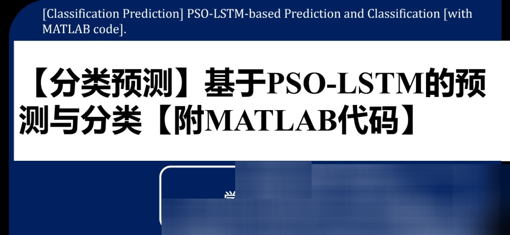

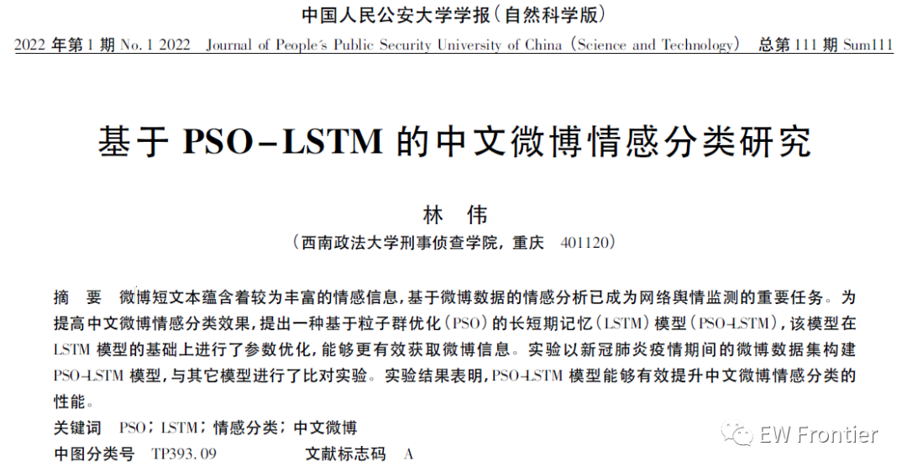
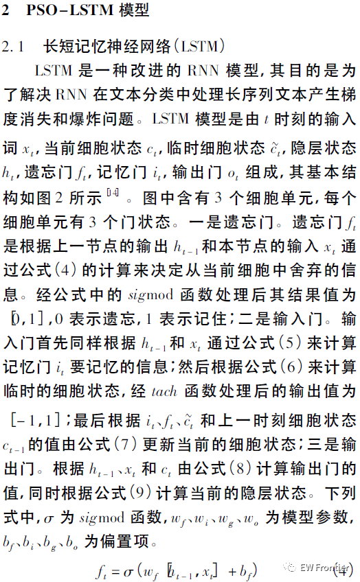
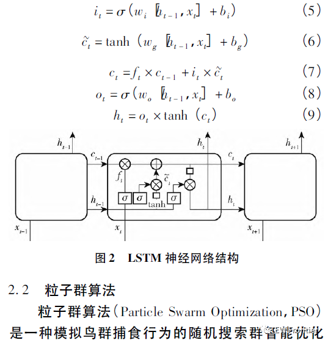
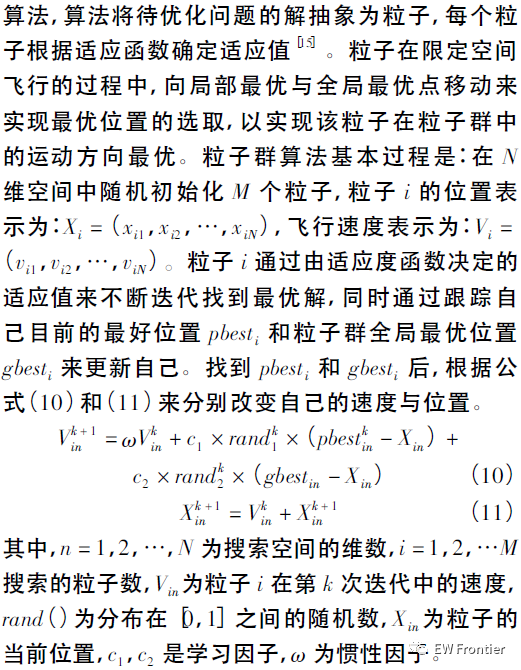
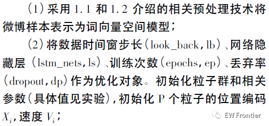
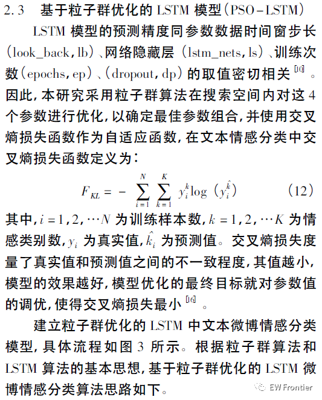
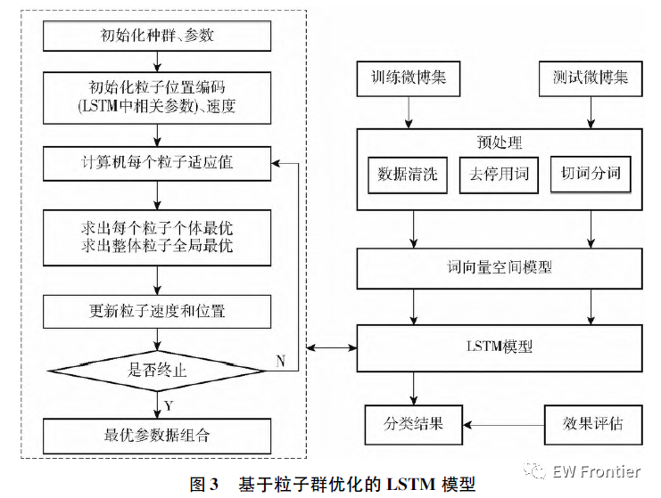
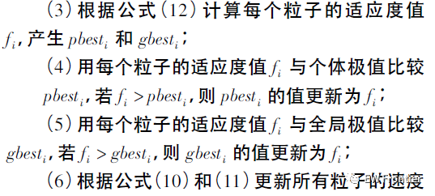
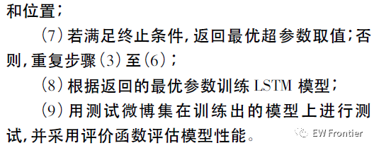
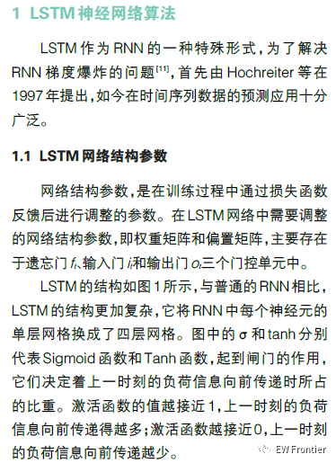
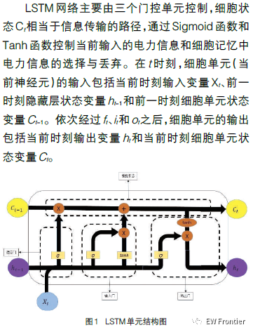
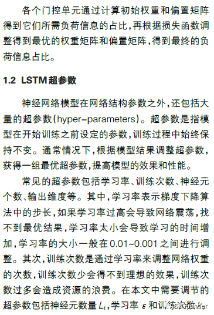
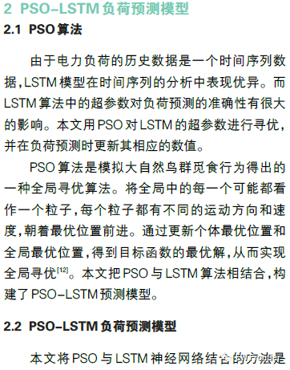
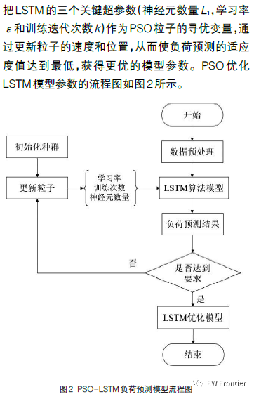
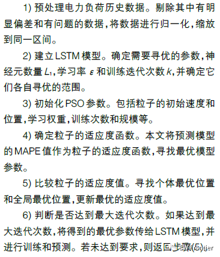
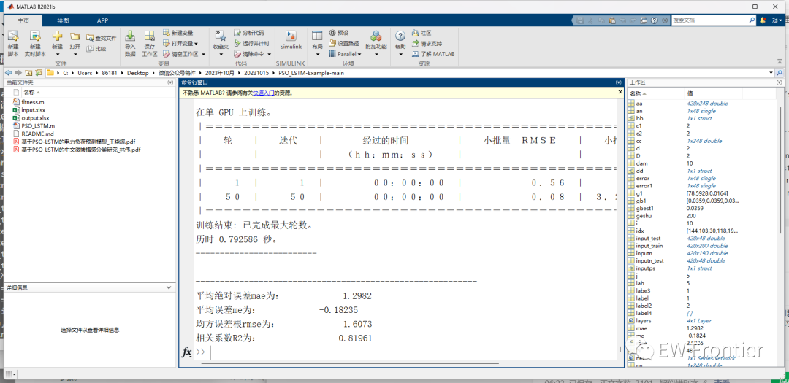
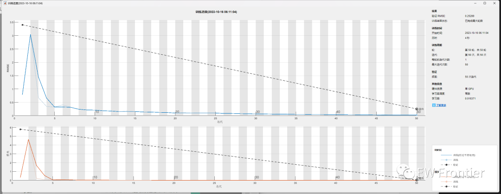
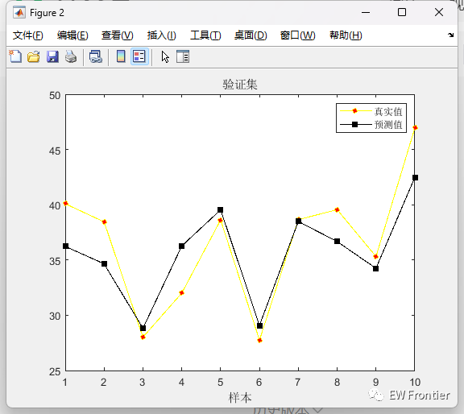
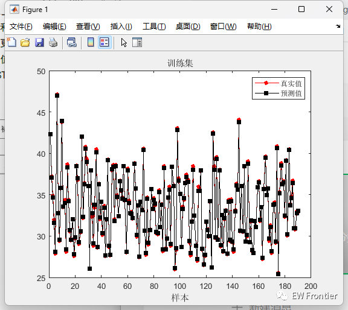
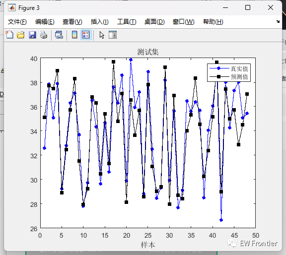

<!-- PAYMENT_BLOCK -->

## Get this dataset

- Payment link (Stripe): [Buy now](https://buy.stripe.com/3cs8yP7sY87d0vu9AB)
- Payment QR code: 

<!-- /PAYMENT_BLOCK -->
